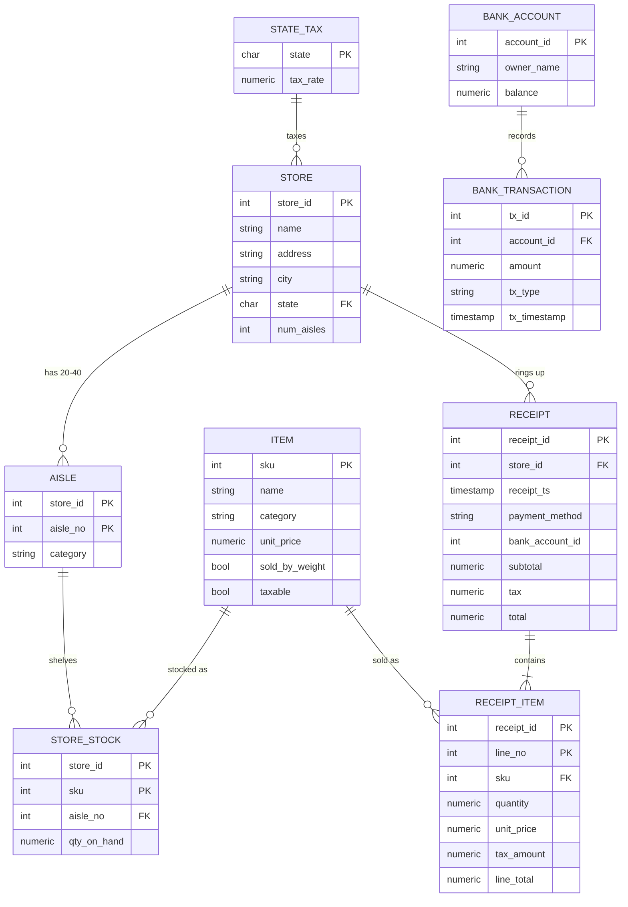

# Supermarket chain - HW4 Phase 1

## Run it
1. Install Node.js and PostgreSQL, then create the database: `createdb supermarket`
2. `npm install`
3. `PGPASSWORD=yourpassword npm start` (defaults: user `postgres`, password `postgres`, db `supermarket`, host `localhost`)
4. Open http://localhost:3000/home.html
5. Click **Create tables**, then **Initialize lookup data**, then **Checkout one customer** or **Run simulation**.

`transaction.sql` and `query.sql` are written automatically in this folder as the app runs.

## Preliminary ER model

The bank is its own set of tables (schema `bank`). `receipt.bank_account_id` references the account by value only, with no cross-system foreign key. Both schemas live in one PostgreSQL database so the checkout can be a single ACID transaction.

Composite keys: `aisle(store_id, aisle_no)`, `store_stock(store_id, sku)`, `receipt_item(receipt_id, line_no)`.
`receipt_item` is the most detailed table: price, quantity or weight, tax and line total for every receipt line.

## Normalization notes (to justify in the report)
- All tables are in BCNF. Every non-key attribute depends on the whole key and nothing else.
- Deliberate 3NF violations (derived or snapshot values):
  - `receipt_item.unit_price` and `tax_amount` are snapshots, so old receipts stay correct when prices or tax rates change.
  - `receipt.subtotal`, `tax` and `total` are derived from the lines, stored for fast reports.

## Checkout transaction (see `transaction.sql` after a run)
`BEGIN` -> insert receipt -> insert 10-20 random receipt lines -> decrement `store_stock` -> compute totals -> debit customer `bank.account` -> credit merchant account -> insert two `bank.bank_transaction` rows -> `COMMIT`. Any error, including insufficient funds (CHECK `balance >= 0`), triggers `ROLLBACK`.

## Phase 1 checklist
- [x] 9 SQL tables (>= 5), keys and referential integrity, composite keys, indexes
- [x] One transaction updating several tables, including the bank account
- [x] 5 report queries, all with joins (most with GROUP BY)
- [x] GUI buttons: create tables, initialize lookup data, browse 10 rows, delete rows (with confirmation), checkout, simulation, stop
- [x] SQL shown in the GUI and logged to `transaction.sql` / `query.sql`
- [ ] TODO (team): copy of 5 real supermarket receipts and how each field maps to the tables
- [ ] TODO (team): polished UML ER diagram (draw.io) based on the model above, plus the team task split
