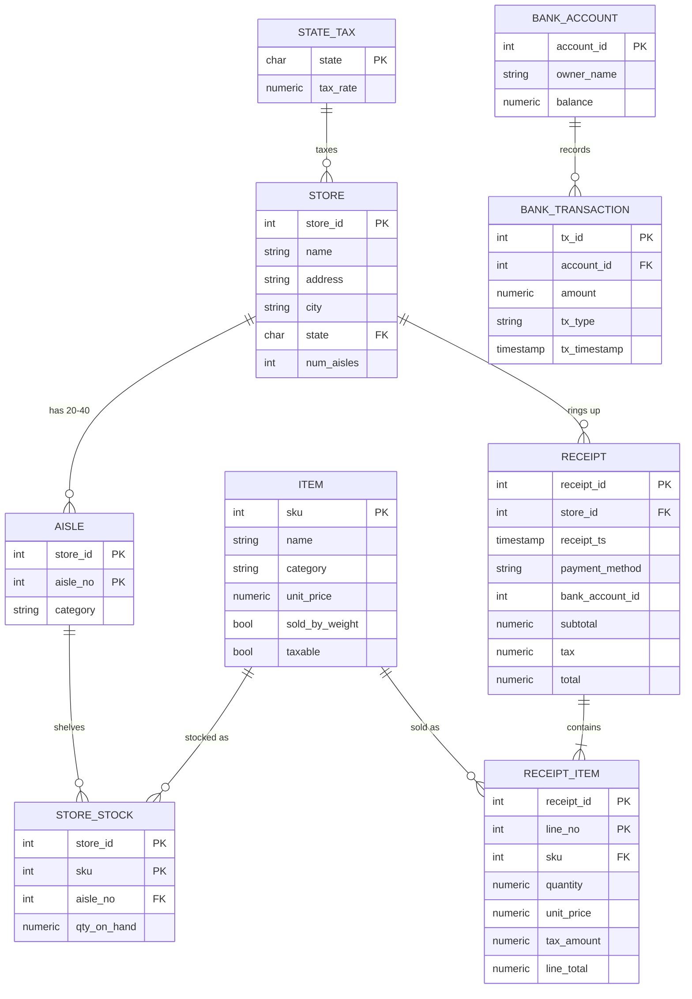

# Supermarket Chain Enterprise Management System — COSC 3380 (Phase 2)

An end-to-end relational database and full-stack web application simulating enterprise retail operations, multi-store inventory management, electronic banking settlements, concurrent OLTP checkout processing, and analytical back-office reporting.

* **Course:** COSC 3380 — Database Systems (Instructor: Dr. Carlos Ordonez)
* **Team:** Team 22
* **Stack:** Node.js, Express, PostgreSQL (`pg`), HTML5/CSS3/Vanilla JavaScript

---

## Team 22 Work Distribution

* **Trey Langley:** Full-stack Node.js/Express backend (`server.js`), multi-customer business simulation and concurrent connection engines, sub-millisecond latency instrumentation, automated SQL trace logging (`transaction.sql` / `query.sql`), and UH course server (`~/hw4`) SSH/SCP deployment.
* **Miguel A. Duran:** Relational DDL architecture (`schema.sql`), BCNF/3NF normalization design, 100-store / 6-state / 51-account dataset generation (`init.sql`), B-Tree index tuning, and GitHub repository management.
* **Youssef Selim:** Interactive web dashboard (`public/home.html`), 5-supermarket empirical receipt analysis, ER-to-relational field mapping, UML ER modeling (`Supermarket_er.drawio`), and technical report compilation (`team22.pdf`).

---

## Project Deliverables & Quick Links

* **Demo Video :** `https://youtu.be/n8fpA00wz7g`
* **Editable UML ER Model:** `Supermarket_er.drawio` (created in draw.io)
* **Final Written Report:** `team22.pdf`

---

## How to Run Locally

### 1. Prerequisites
* **Node.js** (v18+) and **PostgreSQL** (v14+) installed and running locally.
* Create the target PostgreSQL database:
  * **Windows PowerShell:**
    ```powershell
    & "C:\Program Files\PostgreSQL\18\bin\psql.exe" -U postgres -c "CREATE DATABASE supermarket;"
    ```
  * **macOS / Linux:**
    ```bash
    createdb -U postgres supermarket
    ```

### 2. Install Dependencies & Start the Server
1. Navigate to the project directory and install Node packages:
   ```bash
   npm install
   ```
2. Start the Express server (defaults to `PGHOST=localhost`, `PGPORT=5432`, `PGUSER=postgres`, `PGPASSWORD=postgres`, `PGDATABASE=supermarket`):
   * **Windows PowerShell (if using a custom password):**
     ```powershell
     $env:PGPASSWORD="your_password"; npm start
     ```
   * **macOS / Linux:**
     ```bash
     PGPASSWORD=your_password npm start
     ```
3. Open **`http://localhost:3000/home.html`** in your browser.

### 3. Walkthrough of GUI Controls
1. **Create Tables (DDL):** Executes `schema.sql` to build all 9 tables across `public` and `bank` schemas along with 5 B-Tree indexes.
2. **Initialize Lookup Data (100 Stores):** Executes `init.sql` to seed 6 state tax jurisdictions, 100 stores (each with 20–40 aisles), 30 grocery/household items, 3,000 shelf stock entries, and 51 bank accounts.
3. **Checkout 1 Customer (ACID Tx):** Runs a single multi-table `BEGIN ... COMMIT` transaction for 10–20 random items. *(Tip: Testing Account `#1005`, which starts with `$25.00`, demonstrates automatic `ROLLBACK` enforcement on insufficient funds.)*
4. **Simulate Business Operation:** Automatically simulates 100 customer checkouts across all 100 stores (or 3 random locations), displaying total gross revenue and average transaction latency in `ms`.
5. **Simulate Concurrent Connections:** Launches 8 parallel PostgreSQL pool connections (`Promise.all`) simultaneously targeting the same store/account to demonstrate row-level locking, ACID isolation, and contention handling.
6. **Time-Interval Transaction Viewer:** Filters and displays receipts or bank transactions committed within the last `5`, `15`, `60`, or `1,440` minutes.
7. **Back Office Reports:** Executes 5 analytical `JOIN` and `GROUP BY` queries (`Sales by State`, `Top 10 Best Sellers`, `Low Stock Alert`, `Bank Account Balances & Activity`, and `Latest Receipt Line-Item Detail`).
8. **STOP / CANCEL:** Immediately aborts active frontend requests (`AbortController`) and halts running server-side batch simulations.

> **Automated SQL Trace Logging:** Every transaction executed by the app is automatically appended to `transaction.sql`, and every analytical/browse query is logged to `query.sql`.

---

## Database Architecture & ER Model



### Key Relational Design Highlights
* **Multi-Schema Separation:** Retail operations reside in `public` (7 tables) while electronic banking balances and ledgers reside in a separate `bank` schema (`bank.account`, `bank.bank_transaction`), coordinated atomically within a single PostgreSQL ACID transaction.
* **Composite Keys:** `aisle(store_id, aisle_no)`, `store_stock(store_id, sku)`, and `receipt_item(receipt_id, line_no)`.
* **Integrity Constraints:** Strict `CHECK` constraints enforce `num_aisles BETWEEN 20 AND 40`, `qty_on_hand >= 0`, `balance >= 0`, `quantity > 0`, and valid payment/transaction types.
* **B-Tree Indexes:** `idx_receipt_store`, `idx_receipt_ts`, `idx_stock_store_sku`, `idx_receipt_item_sku`, and `idx_bank_tx_ts`.

---

## Normalization Justification (BCNF & 3NF)

* **BCNF Compliance:** All 9 relations satisfy Boyce-Codd Normal Form (BCNF), where every non-trivial functional dependency has a superkey on its determinant side.
* **Intentional 3NF Denormalizations (Justified):**
  1. **Historical Price & Tax Snapshots (`receipt_item.unit_price`, `receipt_item.tax_amount`):** Stored at checkout time so future updates to `item.unit_price` or `state_tax.tax_rate` never retroactively alter historical customer receipts.
  2. **Derived Header Totals (`receipt.subtotal`, `receipt.tax`, `receipt.total`):** Cached at transaction commit time to avoid expensive multi-million-row re-aggregations during financial reporting and bank reconciliation.

---